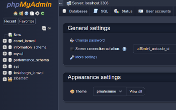

# Midnight — a modern dark theme for phpMyAdmin



**Midnight** is a modern, elegant dark theme for [phpMyAdmin](https://www.phpmyadmin.net/) 5.2.
It is a complete visual redesign of the default `pmahomme` theme, built from a carefully
sampled dark palette (matched to a reference screenshot) instead of a generic invert —
one coherent token layer drives every component.

## Features

- **One source of truth for color** — all surfaces, text, borders and accents are defined
  as tokens in `scss/_variables.scss` and flow into every component.
- **Fully dark form controls** — inputs, textareas, selects, checkboxes and radio buttons;
  no white browser defaults left anywhere.
- **Every surface covered** — content area, sidebar/database tree, toolbars, tables
  (with striping and hover rows), SQL editor and results, tabs, dropdowns, pagination,
  modals, alerts, tooltips, icons.
- **Dark third-party widgets** — CodeMirror SQL editor with syntax highlighting,
  jQuery UI, and the GIS/map controls are re-skinned too.
- **Thoughtful interaction states** — hover, focus, active, selected and disabled states
  are redesigned for dark surfaces with visible focus rings.
- **RTL stylesheet included** — `css/theme.rtl.css` (generated with [rtlcss]).
- **Native dark mode** — `color-scheme: dark` matches scrollbars and widgets to the theme,
  while `@media print` keeps paper output on a white background.
- **Visual only** — no PHP, no JavaScript, zero functional changes.

## Color palette

| Role                              | Hex       |
| --------------------------------- | --------- |
| Page background                   | `#343b4d` |
| Chrome (sidebar, top bars, inputs)| `#1f2536` |
| Deep surfaces (tabs, dropdowns)   | `#181f30` |
| Sunken (code blocks, wells)       | `#1d2334` |
| Panels (cards, dialogs, popups)   | `#2a3040` |
| Hover / active surfaces           | `#3b4356` / `#47516a` |
| Borders / soft dividers           | `#464e64` / `#394053` |
| Primary text (9.3:1 on page)      | `#e8eaed` |
| Muted text (4.9:1 on page)        | `#a3abbd` |
| Accent — links, focus, active tab | `#8ab4f8` |
| Filled primary button             | `#2f5cc4` |
| Success / warning / danger / info | `#2ea043` / `#d9a406` / `#e5534b` / `#4f8ce8` |

Each status color ships with a matching dark background and light text variant
(`scss/_variables.scss`), so alerts and badges stay readable.

## Compatibility

- phpMyAdmin **5.2** (tested on 5.2.3)
- Modern evergreen browsers (Chrome, Edge, Firefox, Safari)

## Installation

### A. From a release zip (recommended)

1. Download `midnight-x.y.z.zip`.
2. Unzip it into the `themes/` directory of your phpMyAdmin installation, so you get
   `themes/midnight/`.
3. Pick **midnight** from the theme selector at the bottom of the phpMyAdmin home page,
   or set it as default in `config.inc.php`:

   ```php
   $cfg['ThemeDefault'] = 'midnight';
   ```

### B. From git

```sh
cd /path/to/phpmyadmin/themes
git clone https://github.com/sa2ncom/midnight.git
```

> Note: GitHub's "Download ZIP" unpacks as `midnight-main/` — rename the folder to
> `midnight` after extracting, otherwise the theme will not be listed.

## Building from source

The SCSS imports phpMyAdmin's shared Bootstrap sources (`../../bootstrap/scss`), so the
build must run inside a phpMyAdmin checkout where this folder sits in `themes/midnight`.
You need Node.js with `sass`, `postcss-cli` and `autoprefixer` installed.

```sh
cd /path/to/phpmyadmin

# 1. compile SCSS → CSS (compressed, with source map)
npx sass themes/midnight/scss:themes/midnight/css --style=compressed

# 2. add vendor prefixes
npx postcss themes/midnight/css/theme.css --use autoprefixer --replace

# 3. generate the RTL variant
npx rtlcss themes/midnight/css/theme.css themes/midnight/css/theme.rtl.css
```

Never edit `css/theme.css` by hand — it is generated. Change the files in `scss/`
and rebuild.

## Verification

- Runtime audits across **25+ screens** (server home, database/table structure, browse,
  SQL editor, export/import, operations, search, privileges, settings, login, modals,
  console): **zero light surfaces and zero contrast failures below 3:1**.
- Static scan of the built CSS: every remaining light value lives inside
  `@media print` only (white paper output is intentional).
- `css/theme.css` and `css/theme.rtl.css` are verified to contain identical rule counts.

## Credits and license

- Based on **pmahomme**, the default phpMyAdmin theme, by the phpMyAdmin developers.
- Built on the libraries shipped with phpMyAdmin (Bootstrap, CodeMirror, jQuery UI).
- Licensed under the [GNU General Public License v2.0-or-later](https://www.gnu.org/licenses/old-licenses/gpl-2.0.html),
  the same license as phpMyAdmin itself.

Issues and suggestions: <https://github.com/sa2ncom/midnight/issues>

[rtlcss]: https://rtlcss.com/
